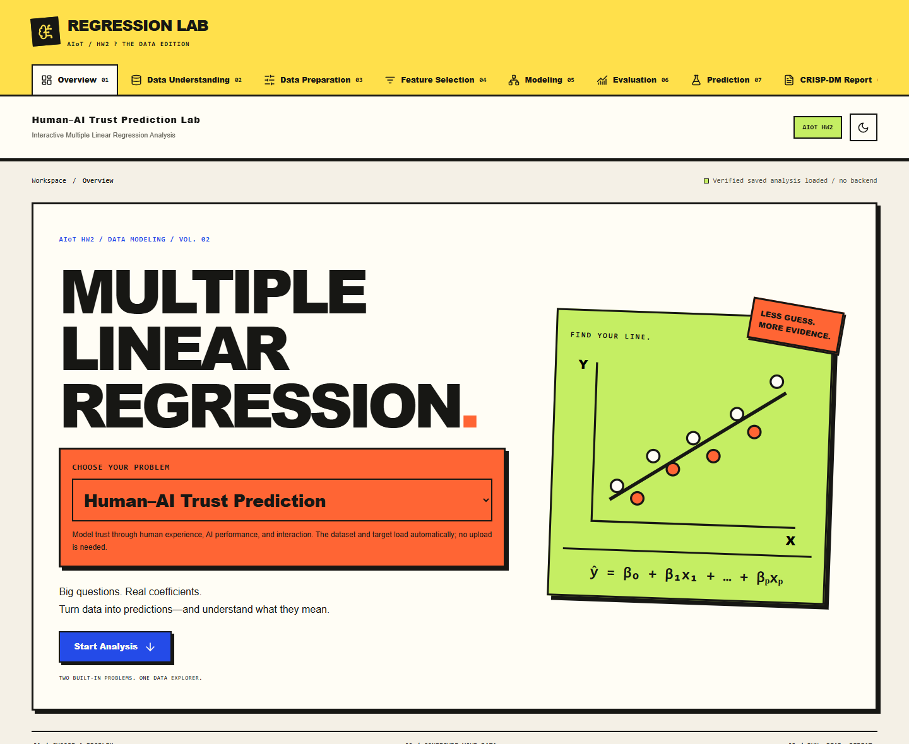
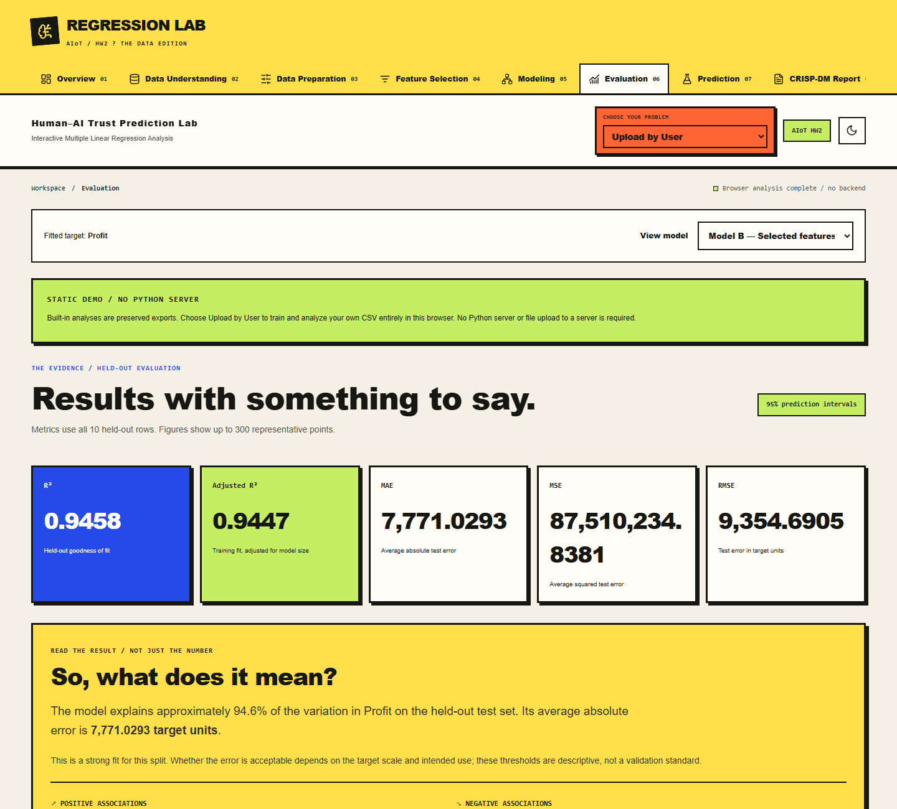
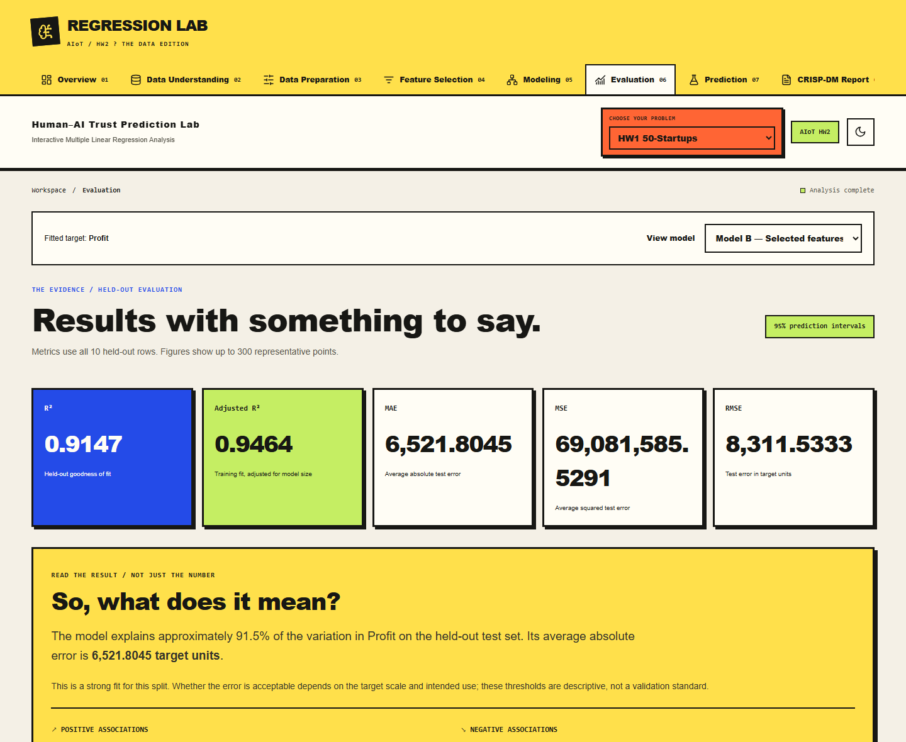

# AIoT HW2 | Regression Lab



**Multiple Linear Regression, from raw data to an explainable prediction.** A React + FastAPI homework application with two built-in problems, user-provided CSVs, feature selection, model comparison, prediction intervals, and a six-stage CRISP-DM report.

[Quick start](#quick-start) | [Website screenshots](#website-screenshots) | [Analysis modes](#three-analysis-modes) | [Methodology](#regression-workflow) | [Results](#results-and-interpretation) | [Verification](#verification)

## GitHub Pages: static demo, no Python server

The existing interface now supports **two modes**. GitHub Pages preserves built-in JSON results and can also train real models from uploaded CSVs in a browser Web Worker; `npm run dev` retains the original full React + FastAPI application. This change prepares deployment locally and does **not** publish the site.

| Feature | Static GitHub Pages mode | Local full mode |
| --- | --- | --- |
| Both built-in datasets, charts, metrics, coefficients and CRISP-DM reports | Preserved exports | Actual Python analysis |
| Model A/B switching and live predictions with verified 95% intervals | In-browser | Backend API |
| Change seed, split, k, scaling or predictors | Supported for uploaded CSV; built-in exports stay fixed | Supported |
| Upload CSV and retrain | Real browser training: up to 10 MB / 20,000 rows | Supported with larger server limits |
| Persistent Python backend | Not needed | Required |

**Teacher upload workflow:** choose **Upload by User**, select a local CSV, click **Load Dataset**, choose a numerical target/features and click **Run Analysis**. Results, predictions, charts and report downloads work without Python. See [browser CSV analysis](docs/BROWSER_CSV.md) for limits, mathematical details and validation.

**Static demo quick start** (uses committed exports):

```powershell
cd frontend
npm ci
npm run dev:static
```

Open `http://127.0.0.1:5173/Aiot-HW2/`. For production preview, run `npm run build:static` and `npm run preview:static`, then open `http://127.0.0.1:4173/Aiot-HW2/`.

**Regenerate actual analyses** from the root: `.\.venv\Scripts\python.exe scripts/export_static.py`. This creates a new versioned export and preserves existing data/results. Then run `npm run verify:static` and `npm run build:static` in `frontend`.

**Publish later:** push the reviewed files, set repository **Settings -> Pages -> Source -> GitHub Actions**, then manually run **Static GitHub Pages demo (manual)**. The workflow defaults to building/testing only; explicitly check `publish` when you want to make it public. The repository path is `/Aiot-HW2/`; the workflow derives it from the repository name.

Verification: **440 preserved-model comparisons plus 3,390 browser-training numerical checks passed**, static desktop/mobile browser tests passed, and all seven original data/result checksums are unchanged. See [the verification record](docs/STATIC_VERIFICATION.md).

See **[the complete static-mode guide](docs/STATIC_MODE.md)** for provenance, browser prediction mathematics, validation, configuration, deployment steps and restoring the pre-change snapshot. The remainder of this README describes the original local/full workflow unless a static-mode difference is stated.

## Website screenshots

The following screenshots show the application's main workflow. Images are stored in [`docs/screenshots/`](docs/screenshots/) and embedded with relative paths so they display when browsing the repository on GitHub.

### Overview and problem selection

The opening screenshot above shows the static demo with **HW1 50-Startups** selected. The orange **CHOOSE YOUR PROBLEM** dropdown switches between the two built-in datasets and **Upload by User**. The green banner identifies browser-only mode; built-in results come from preserved Python analyses.

### CSV analysis in the browser



After uploading the 50-Startups CSV through **Upload by User** and running analysis, **Evaluation** displays the selected model, held-out metrics, and an interpretation of the fitted result. The status **Browser analysis complete / no backend** confirms that this example was trained in the browser. Browser CSV training uses its own documented shuffle, so its split and metrics can differ from the preserved Python results even with the same seed.

### Local FastAPI analysis



The local full application presents the same evaluation workflow using the FastAPI regression pipeline. Screenshot values illustrate the captured dataset and configuration; they are not expected results for every upload or split. See [results and interpretation](#results-and-interpretation) for metric definitions and statistical limits.

## The interface

Warm paper backgrounds, bold typography, thick black borders, hard shadows, cobalt actions, and orange/yellow/lime panels give the application a neo-brutalist visual identity. The design keeps data configuration, statistical evidence, and interpretation visible and understandable for classroom demonstrations.

- A large **CHOOSE YOUR PROBLEM** dropdown sits directly below the main heading.
- A compact dropdown appears in the sticky header after the primary control scrolls out of view, and remains available in other analysis views.
- Both dropdowns and the numbered mode cards use the same problem state.
- Switching problems loads the relevant dataset/configuration and clears previous fitted results and predictions.
- CSV import controls appear only for **Upload by User**.
- Native keyboard-accessible dropdowns, visible focus states, responsive layouts, loading feedback, disabled duplicate actions, and explicit validation errors support the workflow.

## Three analysis modes

| Dropdown choice | Data | Target | How it works |
| --- | --- | --- | --- |
| **HW1 50-Startups** | Built-in `50_Startups.csv`, 50 rows and 5 columns | `Profit` | Automatically loads the dataset, target, and relevant predictors. No upload required. |
| **Human-AI Trust Prediction** | Built-in Kaggle Human-AI Interaction, version 1; 10,100 rows and 21 columns | `latent_trust_score` | Automatically loads the acquired dataset and its 20 predictors. No upload required. |
| **Upload by User** | Your UTF-8 CSV, uploaded locally or imported from a direct public HTTPS URL | A numerical column you select | Detects column types, previews rows, and lets you choose the target and feature columns. |

The Human-AI mode is selected when the application first opens. The first numbered card retains the title **Problem 1**; its dropdown label is **HW1 50-Startups**.

### HW1 50-Startups

Predict business profit using these original predictors:

| Predictor | Type |
| --- | --- |
| `R&D Spend` | Numerical |
| `Administration` | Numerical |
| `Marketing Spend` | Numerical |
| `State` | Categorical; encoded relative to a reference state |

The source is [Avik Jain's 100 Days of ML Code dataset](https://github.com/Avik-Jain/100-Days-Of-ML-Code/blob/master/datasets/50_Startups.csv). The backend uses a local cached CSV when available; otherwise it downloads that source. The 50-row dataset makes a held-out split small, so its metrics should be interpreted with that limitation in mind.

### Human-AI Trust Prediction

The project uses the authentic downloaded records from [Eshaal Malik's Human-AI Interaction dataset, version 1](https://www.kaggle.com/datasets/eshaalnmalik/human-ai-interaction/versions/1). The source describes the records as **synthetic educational data**, not a real-user survey; its recorded data-card license is CC0.

| Predictor group | Columns |
| --- | --- |
| Human factors | `age`, `education_level`, `technical_experience`, `cognitive_load`, `prior_ai_exposure` |
| AI factors | `model_accuracy`, `explainability_score`, `bias_level`, `decision_latency`, `error_rate` |
| Interaction factors | `interaction_frequency`, `ui_complexity`, `feedback_quality`, `trust_history`, `override_frequency` |
| Context | `task_risk`, `domain`, `time_pressure`, `cultural_factor`, `regulatory_strictness` |

Verified source profile: 20 predictors (14 numerical and 6 categorical), 100 exact duplicate rows, and 4,245 missing cells including 201 missing targets. The documented target scale is 0-100; observed nonmissing scores range from approximately 38.374385 to 100.

The acquisition script pins version 1 and records the source, schema, SHA-256 checksum, missingness, and duplicates in a local provenance manifest. The backend validates the checksum and version when loading. Missing or invalid source data produce an error rather than substitute records. See [dataset provenance](data/README.md).

### Upload by User

1. Select **Upload by User**.
2. Choose **Upload CSV File** or **CSV URL**, then **Load Dataset**.
3. Inspect the detected numerical/categorical types and preview rows.
4. Select a numerical target and at least one suitable predictor. Exclude identifiers and target-derived information.
5. Configure the split, seed, preprocessing, and selected-feature count, then run analysis.

CSV headers must be unique and nonempty. Files must be UTF-8 comma-separated tables with a header row. Limits include 150 MB by default (configurable up to 200 MB), 2-100 columns, at least 12 rows, at most 1.5 million rows subject to a 30-million-cell limit, and at most 30 category levels per categorical predictor. The encoded design is limited to 100 columns and 30 million cells. Training also requires sufficient labeled rows for the selected design and a nonconstant numerical target.

Custom configurations are retained in page memory when switching away and restored on return, while fitted outputs are cleared and require a new run. Failed replacement imports preserve the prior custom dataset and configuration. A browser refresh clears these drafts; expired backend sessions require reimport.

## Quick start

These commands start **local full mode**, including FastAPI. For the no-backend version, use the static quick start above.

Use **Python 3.12** and **Node.js 22 LTS** with npm. Dependency installation and dataset acquisition require internet access. Commands below use Windows PowerShell; run them from the repository root unless indicated otherwise.

```powershell
git clone https://github.com/lk000055668/Aiot-HW2.git
cd Aiot-HW2
python -m venv .venv
.\.venv\Scripts\python.exe -m pip install -r backend/requirements.txt
.\.venv\Scripts\python.exe scripts/acquire_data.py
```

The acquisition command downloads the pinned public Kaggle source and writes `data/human-ai-interaction.csv` and `data/trust-source.json`. No credentials are required by this public download implementation. Dataset files are excluded from Git; a fresh clone needs this step for the default Human-AI mode. If acquisition fails, the Startup and user-upload workflows remain available.

**Terminal 1 - backend:**

```powershell
.\.venv\Scripts\python.exe -m uvicorn backend.main:app --host 127.0.0.1 --port 8000 --workers 1
```

**Terminal 2 - frontend:**

```powershell
cd frontend
npm ci
npm run dev -- --host 127.0.0.1
```

Open [the application](http://127.0.0.1:5173). API documentation is at [FastAPI /docs](http://127.0.0.1:8000/docs), and the health endpoint is `GET /api/health`.

On macOS/Linux, create the same virtual environment and use `.venv/bin/python` instead of `.venv\Scripts\python.exe`.

### A classroom demonstration

1. Choose **HW1 50-Startups** in the orange dropdown; wait for its automatic dataset summary.
2. Inspect the target, selected predictors, and preview. The default split is 80% training / 20% testing with seed 42.
3. Click **Run Analysis**. Loading feedback appears while preprocessing, cross-validation, and fitting run.
4. In **Evaluation**, compare models, inspect metrics, read the equation and interpretation, and examine the charts.
5. In **Prediction**, enter a new observation and inspect its estimate and intervals.
6. Export the **CRISP-DM Report** as Markdown or HTML.
7. Switch to **Human-AI Trust Prediction** or **Upload by User** for a new analysis.

The hero's **Start Analysis** button scrolls to problem selection; **Run Analysis** performs model fitting. Changed controls apply to the next run. Predictions and exports use the last successfully fitted model.

## Regression workflow

In local full mode, both built-in modes and custom data use the same backend pipeline. Static-mode CSVs use the [equivalent browser pipeline](docs/BROWSER_CSV.md) with an explicitly recorded browser-specific shuffle:

1. Validate the numerical target and predictor columns; reject unsuitable identifiers and oversized designs.
2. Remove rows with missing targets. Optionally remove exact duplicates over the chosen predictor/target columns before splitting (enabled by default).
3. Split reproducibly using the selected test fraction (10-40%) and random seed.
4. Fit median numerical imputation and most-frequent categorical imputation on **training data only**.
5. Apply drop-first one-hot encoding, optional numerical standardization, and constant-column removal using the fitted preprocessing.
6. Fit **Model A** using all retained encoded predictors and **Model B** using training-only `SelectKBest(f_regression)` with configurable `k`.
7. Run three-fold training-only cross-validation, refitting preprocessing and selection within each fold, using up to 20,000 training rows.
8. Match scikit-learn `LinearRegression` predictions against statsmodels OLS, evaluate the untouched test partition, and compute statistical intervals when the design supports them.

`k` is capped at the available encoded feature count. It is a user configuration, not an optimum chosen from the test set. Selection operates on encoded columns, so individual category levels can be retained or removed. Feature selection may improve or worsen held-out performance; repeatedly tuning against displayed test metrics compromises that evaluation.

## Results and interpretation

Results use strong bordered panels, readable tables, and large interactive Plotly charts. The selected model can be changed between all features and selected features without retraining.

| Output | Meaning |
| --- | --- |
| **R-squared** | Held-out fit relative to predicting the held-out mean; negative values are possible. |
| **Adjusted R-squared** | Statsmodels **training-fit** R-squared adjusted for model size; it is explicitly distinct from test R-squared. |
| **MAE** | Mean absolute test error, in target units. |
| **MSE** | Mean squared test error, giving larger errors more weight. |
| **RMSE** | Square root of MSE, in target units. |
| **Regression equation** | Fitted intercept plus the weighted retained encoded predictors. |
| **Coefficients and VIF** | Direction and size in fitted model units, plus approximate training-sample multicollinearity diagnostics. |
| **Actual vs. predicted** | Predictions compared with observed test values and an equality reference line. |
| **Residual plots / Q-Q plot** | Evidence about residual structure, changing variance, outliers, and normality. |
| **Prediction intervals** | Classical 95% intervals for new observations, plus held-out coverage and average width. |
| **Dataset preview** | Rows and columns from the loaded dataset. |

Metrics cover the complete held-out partition; plotted observations are sampled to at most 300 points. Data Understanding also provides missingness, duplicates, numerical summaries, correlations, distributions, and a paginated row table.

The plain-language interpretation summarizes explained variation and absolute error, and lists positive and negative fitted associations. Whether performance is adequate depends on the target scale and intended application, not a universal R-squared threshold.

### Equation and statistical limits

```text
predicted target = intercept + sum(coefficient_j * encoded_input_j)
```

A numerical coefficient describes the fitted prediction change for a one-unit input increase while holding other encoded inputs constant. With numerical standardization enabled, the unit is one training standard deviation. Categorical effects compare with the omitted training reference category. Different units and collinearity mean coefficient magnitudes are not directly comparable importance scores; neither coefficients nor F scores establish causality.

Prediction intervals use statsmodels `get_prediction(...).summary_frame(alpha=0.05)` for the fitted OLS design. Mean confidence intervals describe uncertainty in the conditional mean; prediction intervals additionally include new-observation variation. Rank-deficient designs disable intervals. Classical validity depends on linearity, independence, constant error variance, and approximately normal errors; the diagnostics do not prove those conditions. Selected-model intervals omit selection uncertainty.

OLS estimates and intervals are **not clipped** to 0-100. The Trust workflow flags out-of-range estimates and extrapolation beyond training input ranges. Synthetic trust data cannot validate real-user behavior or support causal/population claims.

## CRISP-DM and exports

Eight research views support the six-stage process: **Overview**, **Data Understanding**, **Data Preparation**, **Feature Selection**, **Modeling**, **Evaluation**, **Prediction**, and **CRISP-DM Report**.

The report covers business understanding, data understanding, data preparation, modeling, evaluation, and deployment. It records dataset source/provenance, settings, methods, model metrics, limitations, and figure data. Export Markdown or a self-contained HTML report; download individual charts as PNG through the Plotly toolbar.

## Configuration and deployment

| Setting | Where | Default / purpose |
| --- | --- | --- |
| `VITE_API_URL` | `frontend/.env.local` | `http://localhost:8000`; frontend API origin. Rebuild production assets after changing it. |
| `CORS_ORIGINS` | Backend environment | `http://localhost:5173,http://127.0.0.1:5173`; comma-separated exact frontend origins. |
| `DATA_DIR` | Backend environment | Project `data` directory. |
| `MAX_DATASETS` | Backend environment | 4 active dataset sessions, bounded to 1-8. |
| `MAX_CSV_MB` | Backend environment | 150 MB default; capped at 200 MB. |

See [.env.example](.env.example). Export backend variables in the process environment, or copy the example to `.env` and load it using uvicorn's `--env-file .env`. Keep credentials out of frontend variables and Git.

For a production frontend build, run `npm run build` in `frontend`; output is `frontend/dist`. Vercel configuration is included: use `frontend` as the root directory and set `VITE_API_URL` to the backend's HTTPS origin. A root [Dockerfile](Dockerfile) and [Render blueprint](render.yaml) provide backend deployment configuration. Acquire the Trust dataset on the backend's mounted persistent data directory and configure CORS for the frontend origin. These are deployment files, not evidence of a public hosted application.

Run **one backend worker / one instance**: dataset, job, and fitted-model state are process-local, addressed by opaque UUIDs, and expire after two hours. Restarting the backend loses sessions and models. One training job runs at a time. Larger public deployments need authentication, per-user quotas, shared state, and isolated job execution. URL imports enforce public HTTPS destinations, DNS/IP validation, redirect checks, and download limits.

## Verification

Current checks performed on **2026-10-26**:

- **31 backend tests passed**, including the opt-in acquired-data test, using a workspace-local temporary directory. Two dependency warnings were reported.
- The neo-brutalist frontend passed TypeScript compilation and a production build during the UI update.
- A targeted browser check verified all three modes, automatic loading, stale-result clearing, custom-only uploads, shared selector state, keyboard focus, and desktop/mobile layouts during the selector update.
- The screenshots above were captured from the running local app, including a fresh fit of the actual 50-Startups data.

Reproduce backend checks and actual-data evaluation from the root:

```powershell
$env:RUN_REAL_DATA='1'
.\.venv\Scripts\python.exe -m pytest backend/tests -q --basetemp=.tools/pytest-local
.\.venv\Scripts\python.exe scripts/evaluate_defaults.py
```

The evaluation script writes actual metrics, settings, coefficients, and default predictions to ignored `data/*-verification.json` files. Results depend on the source, seed, preprocessing, selected features, and `k`; screenshots are examples rather than universal performance claims.

Frontend checks:

```powershell
cd frontend
npm run build
npx playwright install chromium
$env:TEST_TRUST='1'
npm run test:e2e
```

The checked-in Playwright suite and GitHub Actions workflow predate the latest UI labels and selector placement. Some browser assertions still target the old interface and need updating; this README does **not** claim that the full legacy browser suite or current GitHub Actions run is green. [VERIFICATION.md](VERIFICATION.md) preserves earlier verification records.

## Technology and repository structure

**Frontend:** React 18, TypeScript, Vite, Tailwind CSS, Radix/CVA button primitives, Lucide icons, and Plotly. **Backend:** FastAPI, pandas, NumPy, scikit-learn, statsmodels, SciPy, and threadpoolctl. **Checks:** pytest/httpx and Playwright; GitHub Actions configuration is included.

```text
backend/
  main.py                  API, bounded sessions, analysis jobs, predictions
  data.py                  CSV ingestion, validation, dataset provenance
  ml.py                    Shared preprocessing, fitting, evaluation, intervals
  reporting.py             Markdown/HTML report generation
  tests/                   Backend correctness and ingestion checks
frontend/
  src/main.tsx             Application state and research views
  src/components/research.tsx  Hero, selectors, metrics, equation, interpretation
  src/components/ui/       Reusable button component
  src/style.css            Responsive neo-brutalist design system
  tests/                   Browser workflows (legacy UI assertions noted above)
scripts/
  acquire_data.py          Pinned public Kaggle acquisition
  evaluate_defaults.py     Reproducible real-data model evaluation
  check_source.ps1         Source check helper
data/README.md             Dataset sources and provenance notes
docs/screenshots/          Website images embedded in this README
Dockerfile / render.yaml   Backend deployment configuration
.github/workflows/         Automated verification configuration
```

Dataset CSVs, provenance manifests, local environments, dependency directories, logs, generated reports/build output, and credentials are excluded from Git. Follow the acquisition instructions after cloning, and preserve source attribution when using or redistributing datasets.
